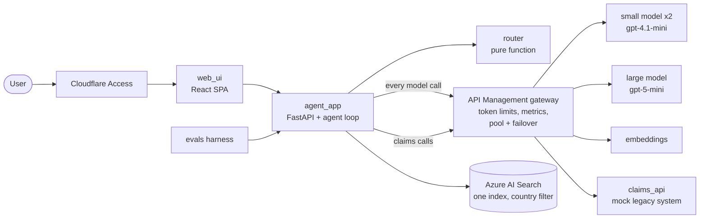

# AI claims assistant

A multilingual insurance claims assistant for a **fictional** insurer (Kalayaan Mutual) in five markets: Philippines, Singapore, Indonesia, Thailand and Japan. It answers in English, Filipino, Cebuano, Bahasa Indonesia, Thai and Japanese, looks up claim status, drafts claims, and never files one without a human approving the draft.

The point of the project is **LLM cost and token optimisation**: every model call goes through a gateway that meters it per country, a router picks the cheapest model that is good enough (backed by evaluation data), and each saving is measured before and after. All data is synthetic.

This is a prototype. See [Known limits](#known-limits).

## Architecture



| Component | Folder | What it does |
|---|---|---|
| Agent app | `components/agent_app` | Agent loop with three tools (`search_policy`, `get_claim_status`, `draft_claim`), human approval, per-turn usage |
| Router | `components/router` | Pure `route()` choosing small, large or human handoff from language, intent, risk and budget state |
| Gateway | `components/gateway` | API Management policy templates (Cloudflare-only IP filter, token limits, metrics, failover) |
| RAG | `components/rag` | Synthetic policy documents, chunking, ingestion and hybrid retrieval |
| Claims API | `components/claims_api` | Deliberately slow and flaky mock of a legacy claims system |
| Evals | `components/evals` | 180-case multilingual golden set, scorers, runner, routing proposal |
| Country packs | `components/country_packs` | One YAML per market, plus the model catalogue and prices |
| Shared | `components/shared` | Pricing, redaction, approval tokens, endpoint checks |
| Web UI | `components/web_ui` | Chat with citations, approval screen, usage side panel |
| Telemetry, budget controller | `components/telemetry`, `components/budget_controller` | Scaffolded; built in milestone M5 |

Infrastructure is Terraform in `infra/` (modules plus an `envs/dev` composition). Decisions are in `docs/adr/`, and progress is logged one line per feature in `docs/progress.md`. The backlog is `FEATURES.md`; the working rules for coding agents are in `AGENTS.md`.

## Try it locally

You need Python 3.12+, [uv](https://docs.astral.sh/uv/), Node with pnpm, and (for deploys) Terraform and the Azure CLI.

```sh
make setup            # installs Python and web dependencies
make run FAKE=1       # runs offline with a rule-based model, no Azure needed
```

Open http://localhost:5273. Try a policy question, `What is the status of claim PH-1042?`, or a filing request with a date, then approve the draft on the approval screen. The usage panel shows the route, tokens, cost and latency of each turn.

`make run` (without `FAKE=1`) uses the real models through the gateway. It needs the environment variables listed in `MANUAL.md`.

## Commands

```
make lint          ruff, mypy, import-linter contracts, eslint + tsc, terraform fmt
make test          unit tests for every component (router must stay at 100% coverage)
make test C=router tests for one component
make e2e           Playwright happy path against `make run FAKE=1`
make plan ENV=dev  terraform plan
make apply ENV=dev terraform apply (needs your explicit approval)
make destroy ENV=dev
make ingest        load the policy documents into AI Search
make load-test ARGS="--report docs/load-test.md"
make build C=agent_app   build one container image
```

Evaluations: `run-evals --agent-url http://localhost:8000 --models small,large` (the agent must run with `AGENT_ALLOW_TIER_OVERRIDE=1`), then `propose-routing` to write a routing proposal for a human to review.

## Deploy

All Azure resources are created by Terraform. Nothing is applied for you.

1. Copy `infra/envs/dev/terraform.tfvars.example` to `terraform.tfvars` and fill in your subscription, owner and alert email (the file is gitignored).
2. `make plan ENV=dev`, review, then `make apply ENV=dev`. The $50 monthly budget alert is created first.
3. Optional pieces are behind flags in `terraform.tfvars`: `enable_apim` (the gateway) and `enable_container_apps` (hosting the three apps).

`MANUAL.md` lists every step that only a human can do (applies, Cloudflare Access, registry, quotas).

## Tear down

`make destroy ENV=dev`, or set `enable_apim = false` and apply to remove just the gateway. The budget alert only alerts; it does not stop spending.

## What it costs

- **API Management (Developer tier) is the big one**, roughly $50 a month by my estimate, about the whole dev budget. Apply it for a test window and destroy it afterwards (ADR-001).
- Model calls are pay-as-you-go: a typical chat turn costs about $0.0004 to $0.0008. The full evaluation run costs a few dollars of tokens.
- AI Search uses the free tier; Key Vault, storage and monitoring are small. Prices in `components/country_packs/models.yaml` are placeholders until replaced with current Azure pricing.

## Known limits

- **No in-app sign-in.** Access is meant to be controlled by Cloudflare Access plus an IP allow list; until that is set up, run it locally only.
- The Cloudflare IP filter alone is not a login (the ranges are shared); a country subscription key is also required on every gateway call.
- Intent and risk classification is keyword rules tuned on the golden set. Real traffic will expose gaps.
- `agent_app` and `claims_api` keep state in memory, so they run as a single replica.
- Translations, policy documents and the golden set are machine-written and not reviewed by native speakers (`reviewed_by_native` is false everywhere).
- There is no CI yet (deferred by decision); the workflows in `.github/workflows` are inert.
- Not built yet: telemetry and the budget controller (M5), the token-optimisation measurements (M6), content-safety configuration and the final decision pack (M7).
- This is not legal advice, and nothing here reflects a real insurer or real regulation.
