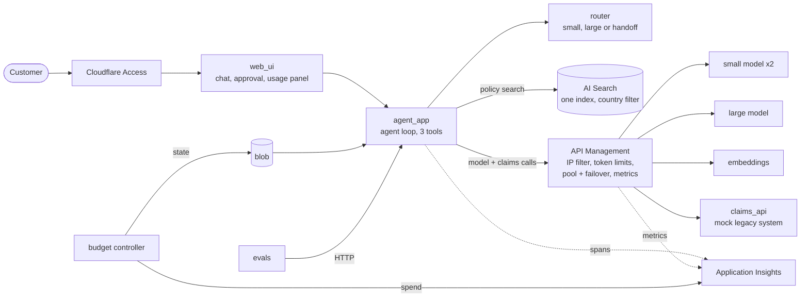

# AI Claims Assistant


> **For reviewers, in 30 seconds:** this repository shows applied AI engineering end to end, not a chat demo. An agent with tools and a human approval step, multilingual retrieval, a data-driven model router, an LLM gateway, an evaluation harness, guardrails, observability and cost control, plus the Terraform that deploys it. Everything is measured, and the failures are written up too.
>
> Jump to: [What this demonstrates](#what-this-demonstrates) · [Results at a glance](#results-at-a-glance) · [Design ideas](#the-design-ideas-worth-a-look) · [Try it](#quick-start)

A production-minded **multilingual claims assistant** and the engineering around it: an agent with tools and human approval, retrieval, a model router, a gateway, an evaluation harness, observability and infrastructure as code, built end to end and measured.

It is a portfolio project that shows how I approach AI systems: design, measurement, safety and operations. The insurer, *Kalayaan Mutual*, is **fictional** and all data is synthetic, but the engineering questions are the real ones: what does an answer cost, which model should have given it, is it safe, and how do you know?

## What this demonstrates

| Capability | What was built | Evidence |
|---|---|---|
| **Agent design** | Tool-using agent loop with a step cap, loop detection, country-scoped tools and localized safe failures. It can draft a claim but has no tool to file or approve one | [`components/agent_app`](components/agent_app), [`docs/architecture.md`](docs/architecture.md) |
| **Safe human-in-the-loop actions** | Signed, expiring, single-use approval tokens bound to the exact draft | [`components/shared`](components/shared), approval tests |
| **RAG across languages and markets** | One hybrid index with a mandatory country filter, per-language analyzers, Japanese-aware chunking, a leak guard that refuses cross-country chunks | [`components/rag`](components/rag), [ADR-004](docs/adr/0004-one-index-with-country-filter.md) |
| **Evaluation engineering** | 180-case golden set in six languages, LLM-judge plus deterministic scorers (tool use, answer language, Japanese politeness, safety), per-language reports, and my own measurement bugs found and fixed along the way | [`components/evals`](components/evals), [`docs/progress.md`](docs/progress.md) |
| **Cost and token optimisation** | Six token levers, each behind a flag and measured before and after (a seventh, a semantic cache, is built but not yet measured); **-31% cost per turn** with no measurable quality loss; levers that did not pay off were left off and reported (one raised cost) | [`docs/unit-economics.md`](docs/unit-economics.md) |
| **Model routing from data** | A pure router (100% line and branch coverage) with rules a human approves, and a proposer that only picks the large model where it clearly beats the small one | [`components/router`](components/router), [ADR-002](docs/adr/0002-rule-based-router.md) |
| **LLM gateway and reliability** | API Management policies for per-country token limits, a model pool with failover and circuit breakers, validated metric dimensions; load-tested live, including a burst that exposed and fixed a shared-pool failure | [`components/gateway`](components/gateway), [`docs/load-test.md`](docs/load-test.md), [ADR-001](docs/adr/0001-gateway-in-front-of-all-models.md) |
| **Guardrails and red-teaming** | Content filter and prompt shields, prompt-injection and poisoned-document tests that ran live, redaction, no prompt text in telemetry outside dev | [`tests/integration`](tests/integration), [ADR-005](docs/adr/0005-telemetry-retention-and-what-is-never-logged.md) |
| **Observability and cost governance** | OpenTelemetry GenAI spans, KQL queries run against real data, a four-tab dashboard, and a budget controller that moves a country to `warn` or `exceeded` and triggers downgrade or handoff | [`components/telemetry`](components/telemetry), [`components/budget_controller`](components/budget_controller), [ADR-006](docs/adr/0006-budget-state-store.md) |
| **Infrastructure as code** | Terraform modules with mocked-provider tests, cost guardrails, keyless identity, optional private networking, and real plans and applies against Azure | [`infra`](infra) |
| **Full-stack delivery** | React + TypeScript UI with a generated API client, IME-safe Japanese input, Thai and Japanese rendering tests, accessibility basics, a Playwright happy path | [`components/web_ui`](components/web_ui) |
| **Engineering discipline** | Architecture rules enforced in lint, 779 tests, decisions written as ADRs, honest limits documented | [`AGENTS.md`](AGENTS.md), [`docs/adr`](docs/adr) |

## Results at a glance

| Measurement | Result | Source |
|---|---|---|
| Small model vs large model, 180 cases per tier | similar quality; large costs **1.6x** and is **1.7x slower**; every adversarial case passed on both | [`components/evals/results/runs/full_golden`](components/evals/results/runs/full_golden) |
| Compact prompts + trimmed retrieval | input tokens **-40%**, cost **-31%**, latency **-16%**, tool accuracy +0.05 | [`docs/unit-economics.md`](docs/unit-economics.md) |
| One country flooding the gateway | it is limited (156 of 180 requests got a 429) while others got 12 of 12 | [`docs/load-test.md`](docs/load-test.md) |
| Poisoned policy document | retrieved and cited, instructions ignored, nothing drafted or approved | [`tests/integration/test_poison_document.py`](tests/integration/test_poison_document.py) |
| Tests | 779 Python and TypeScript tests pass; router at 100% coverage; about 80 Terraform tests with mocked providers | `make test` |

## The design ideas worth a look

- **The agent cannot file a claim.** Not "is told not to": it has no tool for it, and the endpoint that does needs a token only the human's browser holds.
- **Measure before you optimise, and report the losers.** History capping looked sensible and made things 9% more expensive, because it broke prompt caching. It stayed off and is in the write-up.
- **Distrust your own measurements.** Two evaluation scorers were wrong (a judge that could not see tool results, a tool check that punished a refusal); finding that changed the routing proposal.
- **Cost control is a feature, not a report.** Spend per country feeds back into routing: tighter budgets downgrade low-risk work and hand off high-risk work.
- **Adding a market is configuration**: one YAML file plus documents.

## Highlights

| | |
|---|---|
| Languages | English, Filipino, Cebuano, Bahasa Indonesia, Thai, Japanese (polite form checked) |
| Markets | Philippines, Singapore, Indonesia, Thailand, Japan, each with its own rules, budget and retention |
| Agent | Three tools (`search_policy`, `get_claim_status`, `draft_claim`), step cap, loop detection |
| Routing | Small, large or human handoff from language, intent, risk and budget state |
| Gateway | Cloudflare-only IP filter, per-country token limits, model pool with failover, token metrics |
| Safety | Content filter, prompt shields, retrieved text treated as data, poisoned-document test |

## Quick start

You need Python 3.12+, [uv](https://docs.astral.sh/uv/), Node with pnpm, and `make`. Docker is optional. Terraform and the Azure CLI are only needed to deploy.

```sh
git clone https://github.com/keithics/ai-claims-assistant.git
cd ai-claims-assistant
make setup            # Python and web dependencies
make run FAKE=1       # everything offline: a rule-based stand-in for the model
```

Open <http://localhost:5273> and try:

- "How many days do I have to report an incident?" (switch the country between Philippines and Thailand)
- "What is the status of claim PH-1042?"
- "I had a car accident on 2026-10-20, damage about 12000 PHP. Please file a claim." Then open **Review** and approve the draft.

The side panel shows which model answered, why, and what the turn cost. A longer tour is in [`docs/walkthrough.md`](docs/walkthrough.md).

`make run` without `FAKE=1` talks to real models through the gateway, which needs a deployment (see [Deploying to Azure](#deploying-to-azure)).

## How it works



One turn: the message is classified (intent and risk) → the router picks a deployment → the agent calls the model through the gateway and may use its three tools → the answer comes back with citations, any pending approvals and a `usage` block. More in [`docs/architecture.md`](docs/architecture.md).

## Repository layout

```
components/
  agent_app/         FastAPI service: agent loop, tools, approval, routing glue
  router/            pure route() function and routing.yaml
  gateway/           API Management policy templates (XML) and their tests
  rag/               ingestion, chunking, hybrid retrieval, synthetic policy documents
  claims_api/        deliberately slow and flaky mock of a legacy claims system
  evals/             golden set, scorers, runner, run comparison, routing proposal
  telemetry/         OpenTelemetry helpers, KQL queries, dashboard workbook
  budget_controller/ timer function that turns spend into ok / warn / exceeded
  country_packs/     one YAML per market, model catalogue and prices
  shared/            pricing, redaction, approval tokens
  web_ui/            React + TypeScript single-page app
infra/               Terraform modules and the dev environment
docs/                architecture, ADRs, economics, regulatory notes, walkthrough
tools/               load test, local runner, poison-document tool, packaging
tests/               cross-component and live (integration) tests
```

Components only depend on each other along the arrows in [`AGENTS.md`](AGENTS.md), and `import-linter` enforces it in `make lint`.

## Documentation

| Read this | For |
|---|---|
| [`docs/architecture.md`](docs/architecture.md) | the flow of a turn and the trust boundaries |
| [`docs/walkthrough.md`](docs/walkthrough.md) | four flows to try, step by step |
| [`docs/adr/`](docs/adr) | why the gateway, the router, the index, the budget store and the telemetry rules look the way they do |
| [`docs/unit-economics.md`](docs/unit-economics.md) | every optimisation lever measured, with the runs behind each number |
| [`docs/load-test.md`](docs/load-test.md) | one country hitting its token limit while others carry on |
| [`docs/regulatory.md`](docs/regulatory.md) | per-market settings and what to check (not legal advice) |
| [`docs/executive-one-pager.md`](docs/executive-one-pager.md) | a one-page summary for decision makers |
| [`MANUAL.md`](MANUAL.md) | the steps only a human can do |
| [`FEATURES.md`](FEATURES.md), [`docs/progress.md`](docs/progress.md) | the backlog and the log of what was built and measured |

## Development

```sh
make lint            # ruff, mypy, import contracts, eslint, tsc, terraform fmt
make test            # all unit tests (router must stay at 100% coverage)
make test C=router   # one component
make e2e             # Playwright happy path against `make run FAKE=1`
make openapi         # regenerate agent_app/openapi.json after changing the API
```

Conventions worth knowing:

- Python 3.12, `uv` workspace, one package per component; strict `mypy` on `shared`, `router` and `country_packs`.
- The web client is generated from the agent's OpenAPI schema (`pnpm gen:api`); request types are never hand-written.
- Tests for one component never import another's internals. Cross-component and live tests live in `tests/`.
- No real personal data, ever. The redactor and its tests live in `components/shared`.

### Evaluating and tuning

```sh
run-evals --agent-url http://localhost:8000 --models small,large   # needs AGENT_ALLOW_TIER_OVERRIDE=1
compare-runs components/evals/results/runs/baseline components/evals/results/runs/<candidate>
propose-routing                                                    # writes a routing proposal for a human to review
```

Each token lever (`compact_prompts`, `retrieval_trim`, `prompt_cache_key`, `concise_style`, `output_limits`, `history_cap`) is a flag, off by default, that can be switched per request in evaluation runs. The measured decisions are in `docs/unit-economics.md`.

## Deploying to Azure

All Azure resources are created by Terraform. Nothing is applied for you.

1. Copy `infra/envs/dev/terraform.tfvars.example` to `terraform.tfvars` (it is gitignored) and fill in your subscription, owner and alert email.
2. `make plan ENV=dev`, read it, then `make apply ENV=dev`. A $50 monthly budget alert is created first.
3. Optional pieces are flags in `terraform.tfvars`:

   | Flag | Adds |
   |---|---|
   | `enable_apim` | the gateway (API Management) |
   | `enable_container_apps` | hosting for the three apps |
   | `enable_budget_function` | the budget controller function and its alert |
   | `enable_semantic_cache` | a FAQ answer cache on managed Redis (hourly billing) |
   | `enable_private_networking` | private endpoints for AI Services, Search, Storage and Key Vault (hourly billing) |

4. Tear down with `make destroy ENV=dev`, or switch a flag off and apply.

A budget alert only alerts; it does not stop spending.

## What it costs to run

- **The gateway dominates.** API Management on the Developer tier costs roughly $50 a month (an estimate, see ADR-001), about the whole dev budget, so apply it for a test window and destroy it afterwards.
- **Model calls are cents.** About $0.0006 to $0.0013 per turn depending on tier and levers, with placeholder prices in `components/country_packs/models.yaml`. A full 360-case evaluation run costs a few dollars of tokens.
- AI Search uses the free tier; Key Vault, storage and monitoring are small.

## Security and safety design

- **Human in the loop.** The agent has no tool that files or approves a claim. Approval tokens are bound to the exact draft, expire after 15 minutes and work once.
- **Retrieved text is data.** Documents and tool results are wrapped in delimiters and never obeyed; a test plants a poisoned document and checks that nothing is drafted or approved.
- **Models only through the gateway**, with per-country keys in Key Vault; a test fails on any direct model hostname.
- **No prompt text in telemetry** outside the dev environment, and only redacted there.
- **No secrets in the repository**: keys, state files and real `tfvars` are gitignored.

This is a prototype and has not been security reviewed. To report a problem, open an issue without exploit details and say you have more to share.

## Status and known limits

| Milestone | State |
|---|---|
| Scaffold, infrastructure basics, country packs, retrieval | done |
| Agent, claims API, web UI, container hosting | done |
| Gateway with token limits, failover, load test | done |
| Evaluations and router | done; routing proposal awaiting human review |
| Telemetry and budget control | built; gateway telemetry fix and the budget function await an apply |
| Token optimisation levers | measured; semantic cache built but not measured |
| Safety, private networking, documentation | done; private networking is plan-only |

Things to know before relying on it:

- **No in-app sign-in, because this is a proof of concept.** Access is meant to be Cloudflare Access plus an IP allow list, which is fine for synthetic data and not for production, where every user signs in and spend is limited per user (the production list is in [ADR-001](docs/adr/0001-gateway-in-front-of-all-models.md)). Until that is set up, run it locally.
- The Cloudflare IP ranges are shared by every Cloudflare customer, so the filter is not a login; a country key is also required.
- **Data residency is declared, not enforced:** country packs name regions, but all models run on global deployments in one region (ADR-003).
- Intent and risk classification is keyword rules tuned on the golden set; real traffic will find gaps.
- `agent_app` and `claims_api` keep state in memory, so they run as one replica.
- **Translations, policy documents and test cases are machine-written** and not reviewed by native speakers.
- There is no CI yet (deferred by decision); the workflows in `.github/workflows` are inert.
- The model prompt shield did not block one classic jailbreak prompt in a live check (the model declined it); treat it as one layer.
- Not legal advice, and nothing here reflects a real insurer or real regulation.

## About this project

This repository exists to show applied AI engineering work. Read it in this order: the capability table above, [`docs/architecture.md`](docs/architecture.md), then [`docs/unit-economics.md`](docs/unit-economics.md) and [`docs/progress.md`](docs/progress.md) for the measurements and the dead ends. [`AGENTS.md`](AGENTS.md) holds the rules the work was built under (layout, dependency table, hard safety rules).

The code is published for review. No license is granted for reuse; all rights are reserved unless a license file is added.
