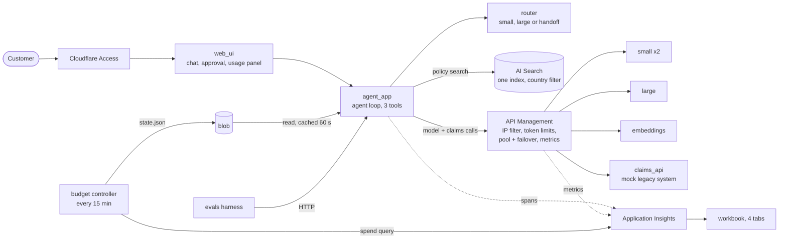

# Architecture

The assistant answers claim questions in six languages for five markets, drafts claims, and never files one without a human approving the draft. Every model call is metered by a gateway, routed by a pure function and traced.

## One turn

1. The browser posts the message, country, language and the history it holds to `agent_app`.
2. `classify` gives an intent and a risk with keyword rules; `route` combines them with the country's allowed tiers and its budget state and returns a deployment, fallbacks and an output limit, or a human handoff.
3. The agent loop calls the model through the gateway with the country's subscription key. It can use three tools: `search_policy` (always filtered to the country), `get_claim_status` (the country's claims only) and `draft_claim` (returns a draft and an approval token).
4. Retrieved text and tool results are wrapped in delimiters and treated as data. The content filter and prompt shields on the deployments block harmful or injected prompts; a blocked turn returns a safe localized message.
5. The response carries the answer, citations, pending approvals and a `usage` block (route, tokens, cost, latency, levers fired) that the usage panel shows without touching telemetry stores.
6. A human reviews a draft on the approval screen; `/approve` verifies the signed, expiring, single-use token and only then asks the claims system to file it.

## Trust boundaries

| Boundary | Control |
|---|---|
| Internet to the app | Cloudflare Access; the gateway and the container apps accept only Cloudflare IP ranges (not a login: the ranges are shared) |
| App to models | Only through the gateway; per-country subscription keys in Key Vault; a test fails on any direct model hostname |
| Model to tools | Three tools only; the agent can draft but never file or approve; retrieved text cannot change that (poison-document test) |
| Claims | Filing needs an HMAC token bound to the exact draft, expiring after 15 minutes, usable once, held only by the browser |
| Telemetry | No prompt text outside dev; redaction in dev; Entra-authenticated ingestion |

## Where things live

| Concern | Place |
|---|---|
| Policies for the gateway | `components/gateway/policies` (loaded by `infra/modules/apim_gateway`) |
| Routing rules | `components/router/routing.yaml` (humans copy eval proposals into it) |
| Markets and prices | `components/country_packs` |
| Budget state | blob `budget-state/state.json` (ADR-006) |
| Queries and dashboard | `components/telemetry/kql`, `components/telemetry/workbook` |
| Decisions | `docs/adr`, numbers in `docs/unit-economics.md` |
